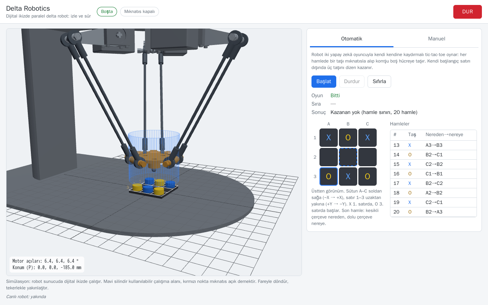
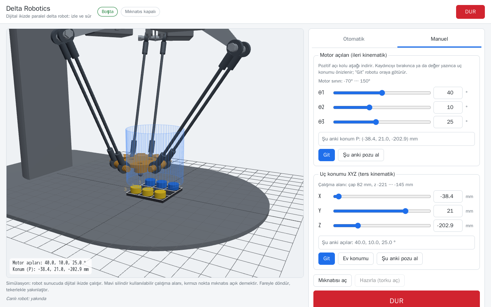

# Delta Robotics V2

[](https://claude.com/claude-code)

V2, [Claude Code](https://claude.com/claude-code) ile geliştirildi: tasarım kararları ve gözden geçirme proje sahibinde, kodlama ve belgeleme Claude Code ile birlikte yapıldı.

> **Durum: rafta (2026-11-12).** F0–F4.5 ve F6 tamamlandı, F5 yazılım yarısı bitti ve askıya alındı. Proje bekletiliyor; yeniden başlatma: [docs/ilerleme.md](docs/ilerleme.md#projeyi-yeniden-başlatma).

Paralel delta robotun (2024 bitirme projesi) ikinci sürümü: aynı mekanik, sıfırdan yazılmış yazılım. Sunucu beyindir (ROS2 Jazzy yığını, C++ kinematik çekirdeği, iki katmanlı güvenlik kapısı, dijital ikiz, API, sandbox); ince ama güvenli bir Raspberry Pi kenarı zaman damgalı yörüngeyi oynatır, son kapıyı ve bekçiyi uygular. Fiziksel robot şu an yok; nihai ürün, robotu simülasyonda gösteren tek sayfalık **deneyim arayüzüdür**:

| Otomatik mod: robot kendi kendine tic-tac-toe oynar | Manuel mod: motor açıları (ileri kinematik) ve XYZ (ters kinematik) |
| --------------------------------------------------- | ------------------------------------------------------------------- |
|        |                            |

Çalıştırmak (Docker Desktop gerekir, `DeltaRobotV2/` içinde): `docker compose --profile demo up -d --build`, sonra tarayıcıda https://localhost:8080 (yerel, kendinden imzalı sertifika).

V2 sıfırdan yazılır. Repodaki eski klasörler (`LikeSoup/`, `KilavuzDeltaRobotics/`, `ImageProcessing/`, `WsAnalysis/`) 2024 bitirme projesinin değiştirilmeyen referansıdır; V2 bu klasörlerin hiçbirine dokunmaz ve onlardan kod almaz.

## Durum

| Faz  | Kapsam                                                                      | Durum           |
| ---- | --------------------------------------------------------------------------- | --------------- |
| F0   | İskele, Docker geliştirme ortamı, Compose, i18n, CI                         | Tamamlandı      |
| F0.5 | FreeCAD ile parametrik 3B model, montaj, renkli görseller                   | Tamamlandı      |
| F1   | C++ kinematik çekirdeği + testler + Python bağlaması                        | Tamamlandı      |
| F2   | Datasheet (etkileşimli HTML)                                                | Tamamlandı      |
| F3   | ROS2 + güvenlik süpervizörü + Pi kenarı + dijital ikiz                      | Tamamlandı      |
| F4   | Uzaktan erişim: API, Python istemcisi, sandbox                              | Tamamlandı      |
| F4.5 | Tic-tac-toe senaryosu (simülasyon)                                          | Tamamlandı      |
| F5   | Yeniden kurulum: yazılım yarısı (AX-12A arka ucu, servo aracı, prosedürler) | Askıda (kısmen) |
| F6   | Tek sayfalık deneyim arayüzü (simülasyon)                                   | Tamamlandı      |

Öne çıkanlar (sayılar [docs/ilerleme.md](docs/ilerleme.md)):

- **Güvenlik:** 14 gereksinimin 12'si (G1–G11, G14) tüm yazılım katmanlarında testle kanıtlandı; G13'ün yazılım tarafı test edildi; donanım katmanı (G12, G13 ve süre ölçümleri) F5 ile askıda. Ayrıntı: [docs/guvenlik-gereksinimleri.md](docs/guvenlik-gereksinimleri.md).
- **Test:** kenar (C++) 190 test, %99 satır; kritik modüllerde mutasyon skoru 130 / 131; protokol ayrıştırıcıda ~175 bin girdilik fuzz, bulgu yok; ROS2 98 + 3; API 67; istemci 99; sandbox 90 birim + G11 59 (gerçek konteyner); çekirdek 22 + 495 (V1 çapraz doğrulama dahil); uçtan uca: ROS + sanal Pi hata enjeksiyonuyla 16 / 16, gerçek istemci → API → ROS → sanal Pi 21 / 21 (tic-tac-toe oyunu dahil); arayüz (Playwright, gerçek simülasyona karşı) 11 / 11.
- **Datasheet:** [docs/datasheet/datasheet.html](docs/datasheet/datasheet.html): çalışma alanı, performans haritaları, tabla, ROS2 ağı, senaryo metrikleri.
- **CAD:** 20 parça, 123 bileşen; [docs/img/cad/](docs/img/cad/).

## Klasör haritası

```
DeltaRobotV2/
  README.md           Bu dosya
  compose.yaml        Konteyner servisleri: dev; demo profili (F6 arayüzü); sim profili (ROS2 + sanal Pi + API + koşucu)
  docker/dev/         Geliştirme imajı: Ubuntu 24.04 + ROS2 Jazzy + C++/Python araçları
  docker/ros/         Sunucu imajı (ROS2 yığını)
  docker/edge/        Sanal Pi imajı (gerçek Pi ile aynı delta_edge ikilisi)
  config/robot.yaml   Robot tanımı: tek ölçü kaynağı (mm, derece)
  cad/                FreeCAD betikleri, montaj, mesh ve kütle çıktıları
  core/               delta_core: ROS'tan bağımsız C++ kinematik çekirdeği + Python bağlaması
  edge/               delta_edge: Pi kenar servisi (C++17, ROS'suz): son kapı, bekçi, oynatıcı
  ros2_ws/            ROS2 paketleri: arayüzler, URDF, sunucu düğümleri, edge_bridge, tabla ikizi
  api/                Komut API'si (FastAPI): REST + WebSocket, iş kuyruğu; sözleşme docs/api.md
  client/             Python istemcisi (pip: delta-robot-client), VS Code'dan kullanım
  web/                F6 tek sayfalık deneyim arayüzü (Türkçe): 3B ikiz, otomatik ve manuel mod
  sandbox/            Kullanıcı kodu koşucusu ve G11 güvenlik testleri
  i18n/locales/       Arayüz metinleri; tr.json kaynak, en.json çeviri
  hardware/           Malzeme listesi: bom.yaml (kaynak) -> bom.csv, bom.md (CAD ile senkron)
  tools/              ci.sh, format.sh, cad.sh, bom.py, i18n denetimi, git kancaları
  tests/              Python testleri, uçtan uca senaryolar (tests/e2e), arayüz testleri (tests/ui, Playwright)
  docs/               Mimari, yol haritası, robot girdileri, geliştirme ortamı
```

Alt klasörler yalnız gerektiği fazda açılır.

## Hızlı başlangıç

Docker Desktop (WSL 2 arka ucu) gerekir. `DeltaRobotV2/` içinde:

```bash
docker compose --profile demo up -d --build
```

Deneyim arayüzü: https://localhost:8080. Durdurmak: `docker compose --profile demo down`.

```bash
docker compose run --rm dev ./tools/ci.sh
```

Tüm denetimler (biçim, BOM, i18n, çekirdek, kenar, API, araçlar + kapsama). Tam yığın ve diğer testler: [docs/ilerleme.md](docs/ilerleme.md#projeyi-yeniden-başlatma). Geliştirme ortamı: [docs/gelistirme-ortami.md](docs/gelistirme-ortami.md)

## Belgeler

- [docs/mimari.md](docs/mimari.md): sistem mimarisi ve güvenlik ilkeleri
- [docs/api.md](docs/api.md): API, istemci, sandbox ve F6 arayüzü sözleşmesi
- [docs/f6-deneyim-arayuzu.md](docs/f6-deneyim-arayuzu.md): deneyim arayüzü tasarımı
- [docs/yol-haritasi.md](docs/yol-haritasi.md): fazlar ve teslimler
- [docs/robot-girdileri.md](docs/robot-girdileri.md): robotun ölçüleri ve mekanik bilgileri, kaynaklarıyla
- [docs/gelistirme-ortami.md](docs/gelistirme-ortami.md): Docker, Compose, CI, kod standardı
- [docs/datasheet/datasheet.html](docs/datasheet/datasheet.html): etkileşimli datasheet
- [docs/ilerleme.md](docs/ilerleme.md): faz ilerlemesi, sayılarla
- [docs/guvenlik-gereksinimleri.md](docs/guvenlik-gereksinimleri.md): güvenlik gereksinimleri ve testleri
- [docs/kabul-testleri.md](docs/kabul-testleri.md): donanım kabul testleri (F5, askıda)
- [hardware/bom.md](hardware/bom.md): malzeme listesi (BOM)
- [docs/kurulum-plani.md](docs/kurulum-plani.md): robot üretilecekse üretim ve kurulum sırası

Belgeler Türkçedir. Arayüz Türkçe; İngilizce katalog hazır (`?lang=en`).
