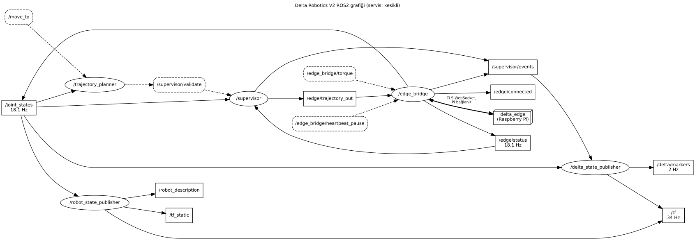

# ROS2 çalışma alanı (sunucu yığını)

Sunucudaki ROS2 Jazzy yığını: kartezyen komutu yörüngeye çevirir, **1. güvenlik kapısından** geçirir, kabul edileni kenara (Raspberry Pi, `delta_edge`) gönderir ve dijital ikizi RViz'de gösterir. Mimari: [docs/mimari.md](../docs/mimari.md), gereksinimler: [docs/guvenlik-gereksinimleri.md](../docs/guvenlik-gereksinimleri.md).

> **Durum.** Kenar köprüsü (`edge_bridge`, TLS WebSocket ile Pi'deki `delta_edge`'e) ana oturumda ekleniyor. Şimdilik `sim_executor` **geçici bir yer tutucudur**: kabul edilen yörüngeyi 100 Hz oynatıp `/joint_states` ve `/edge/status` yayımlar; son kapı (K), bekçi (G6, G7) ve sağlık sınırları (G9) onda **yoktur**. Köprü gelince grafiği yeniden üretin (aşağıda).



## Paketler

| Paket               | Tür          | İçerik                                                                                                                              |
| ------------------- | ------------ | ----------------------------------------------------------------------------------------------------------------------------------- |
| `delta_interfaces`  | ament_cmake  | Mesaj ve servisler: `EdgeStatus`, `SupervisorEvent`, `MoveTo`, `ValidateTrajectory`                                                 |
| `delta_description` | ament_cmake  | URDF (`delta.urdf.xacro`, CAD mesh'leri `../../../cad/out`), RViz yapılandırması (`rviz/delta.rviz`)                                |
| `delta_server`      | ament_python | Düğümler, saf mantık modülleri (`safety`, `planning`, `frames`, `markers`), `config/server.yaml`, `launch/delta.launch.py`, testler |

Geometri ve açı limitleri tek kaynaktan, `config/robot.yaml`'dan (delta_core) okunur; `server.yaml` yalnız sunucuya özgü ayarları (G5 hız/ivme, örnekleme, tabla) tutar.

## Düğümler

| Düğüm                   | Amaç                                                                                                                 | Hız                                      | Güvenlik rolü                                                                           |
| ----------------------- | -------------------------------------------------------------------------------------------------------------------- | ---------------------------------------- | --------------------------------------------------------------------------------------- |
| `trajectory_planner`    | `/move_to` → düz çizgi, quintic zaman profili, 100 Hz örnek, her örnekte delta_core IK; planı süpervizöre doğrulatır | olay                                     | karar vermez; her plan (erişilemeyen örnek NaN) 1. kapıya gider                         |
| `supervisor`            | 1. güvenlik kapısı; kabul edileni `/edge/trajectory_out`'a iletir, her kararı `/supervisor/events`'e yazar           | olay                                     | **1. kapı: G1, G2, G3, G4, G5**; kenar RUNNING/FAULT iken yeni yörünge reddi            |
| `delta_state_publisher` | Dijital ikiz: FK ile bicep/forearm/platform TF'i; marker'lar (tabla, taşlar, uç izi, hedef, ret nedeni)              | TF: `/joint_states` hızında; marker 2 Hz | karar vermez; ret nedenini görünür kılar                                                |
| `robot_state_publisher` | URDF'i `/robot_description` olarak, sabit bağları `/tf_static`'e yayımlar                                            | kalıcı (latched)                         | yok (görselleştirme)                                                                    |
| `sim_executor`          | **GEÇİCİ** sanal Pi: yörüngeyi kendi saatiyle oynatır                                                                | 100 Hz (`/joint_states`), 10 Hz durum    | yok; yalnız sayı olmayan yörüngeyi oynatmaz. `edge_bridge` + `delta_edge` ile değişecek |
| `rviz2` (isteğe bağlı)  | Görselleştirme (`rviz:=true`)                                                                                        | —                                        | yok                                                                                     |

## Konular ve servisler

Hızlar anmadır (ölçülen değerler `graph/ros_graph.json`'da). QoS profilleri `delta_server/common.py`'dedir; hepsi `reliable`.

| Ad                     | Tür    | Tip                                       | Hız                 | QoS                                          | Yayınlayan / sunucu → dinleyen / istemci                                                              | Güvenlik rolü                                           |
| ---------------------- | ------ | ----------------------------------------- | ------------------- | -------------------------------------------- | ----------------------------------------------------------------------------------------------------- | ------------------------------------------------------- |
| `/move_to`             | servis | `delta_interfaces/srv/MoveTo`             | istek               | servis varsayılanı                           | `trajectory_planner` ← kullanıcı / API                                                                | komut girişi; karar 1. kapıda                           |
| `/supervisor/validate` | servis | `delta_interfaces/srv/ValidateTrajectory` | istek               | servis varsayılanı                           | `supervisor` ← `trajectory_planner`                                                                   | 1. kapı girişi (G1–G5)                                  |
| `/edge/trajectory_out` | konu   | `trajectory_msgs/msg/JointTrajectory`     | olay                | volatile, keep_last 10 (`QOS_COMMAND`)       | `supervisor` → `sim_executor` (sonra `edge_bridge`)                                                   | yalnız 1. kapıdan geçmiş yörünge; radyan, 100 Hz ızgara |
| `/supervisor/events`   | konu   | `delta_interfaces/msg/SupervisorEvent`    | olay                | volatile, keep_last 50 (`QOS_EVENTS`)        | `supervisor` → `delta_state_publisher`                                                                | her kararın kaydı (gereksinim + neden)                  |
| `/joint_states`        | konu   | `sensor_msgs/msg/JointState`              | 100 Hz              | volatile, keep_last 10 (`QOS_STATE`)         | `sim_executor` → `supervisor`, `trajectory_planner`, `delta_state_publisher`, `robot_state_publisher` | G5 başlangıç sürekliliği; planın başlangıç noktası      |
| `/edge/status`         | konu   | `delta_interfaces/msg/EdgeStatus`         | 10 Hz + değişimde   | volatile, keep_last 10 (`QOS_STATE`)         | `sim_executor` → `supervisor`                                                                         | RUNNING/FAULT iken 1. kapı yeni yörüngeyi reddeder      |
| `/delta/markers`       | konu   | `visualization_msgs/msg/MarkerArray`      | 2 Hz + olayda       | transient_local, keep_last 1 (`QOS_LATCHED`) | `delta_state_publisher` → RViz                                                                        | —                                                       |
| `/tf`                  | konu   | `tf2_msgs/msg/TFMessage`                  | `/joint_states` ile | volatile                                     | `delta_state_publisher`, `robot_state_publisher` → RViz                                               | —                                                       |
| `/tf_static`           | konu   | `tf2_msgs/msg/TFMessage`                  | kalıcı              | transient_local                              | `robot_state_publisher` → RViz                                                                        | —                                                       |
| `/robot_description`   | konu   | `std_msgs/msg/String`                     | kalıcı              | transient_local                              | `robot_state_publisher` → RViz                                                                        | —                                                       |

Eylem (action) yoktur. Birimler: `/move_to` ve olaylar **mm**, eklem açıları **radyan**, marker'lar **metre**.

## Derleme ve test (konteynerde)

Her şey Docker'da çalışır. Temel imaj (ROS + rviz2 + Xvfb + graphviz + delta_core_py), `DeltaRobotV2/` kökünden:

```bash
docker build -f docker/ros/Dockerfile --target base -t deltarobotv2-ros:base .
```

Açıklama paketi depodaki göreli yolları (`../../../cad/out`, `../../../config/robot.yaml`) beklediği için çalışma alanı geçici bir ağaca kopyalanıp derlenir (Git Bash'te, `DeltaRobotV2/` içinden):

```bash
MSYS_NO_PATHCONV=1 docker run --rm -v "$(cygpath -w "$PWD"):/workspace" -w /workspace --user root deltarobotv2-ros:base bash -c '
  source /opt/ros/jazzy/setup.bash &&
  mkdir -p /tmp/d/cad /tmp/d/ros2_ws && cp -r cad/out /tmp/d/cad/ && cp -r config /tmp/d/ &&
  cp -r ros2_ws/src /tmp/d/ros2_ws/ && cd /tmp/d/ros2_ws && colcon build && source install/setup.bash &&
  python3 -m pytest src/delta_server/test src/delta_description/test \
    --deselect src/delta_server/test/test_launch_integration.py::test_launch_integration &&
  launch_test src/delta_server/test/test_launch_integration.py'
```

Aynı bash satırına `cd /workspace && ...` ile aşağıdaki araçlar eklenebilir. Tam imaj (`docker build -f docker/ros/Dockerfile -t deltarobotv2-ros:latest .`) çalışma alanını `/opt/delta/ros2_ws`'te hazır derler ve giriş noktası onu yükler; kaynak değişince imaj yeniden derlenmelidir.

## Çalıştırma

```bash
ros2 launch delta_server delta.launch.py                  # başsız, sim_executor ile
ros2 launch delta_server delta.launch.py rviz:=true       # RViz ile
ros2 service call /move_to delta_interfaces/srv/MoveTo "{target: {x: 20.0, y: 0.0, z: -205.0}, duration_s: 2.0}"
ros2 topic echo /supervisor/events                        # kararlar
```

`duration_s <= 0` verilirse planlayıcı G5 sınırlarına uyan en kısa süreyi seçer. Launch argümanları `delta.launch.py` başındaki açıklamadadır.

## Ekran görüntüleri

```bash
./ros2_ws/tools/capture_screens.sh [çıktı_klasörü]   # varsayılan ros2_ws/screenshots
```

Xvfb + `rviz2 --fullscreen` (paneller ve menüler kareye girmez), yazılım OpenGL; çıktı 8 bit RGB PNG, 1600×1000. Kamera `delta_description/rviz/delta.rviz`'dedir (`RVIZ_CONFIG` ile değiştirilir). Ayrı `ROS_DOMAIN_ID` (42) ve yalnız yerel keşif kullanır.

| Dosya                                              | İçerik                                                                        |
| -------------------------------------------------- | ----------------------------------------------------------------------------- |
| [01_home.png](screenshots/01_home.png)             | Başlangıç (montaj) pozu, tabla ve taşlar                                      |
| [02_rejected.png](screenshots/02_rejected.png)     | Limit dışı hedef: kırmızı küre, robotun üstünde ret nedeni (G2), küreye çizgi |
| [03_trajectory.png](screenshots/03_trajectory.png) | Hareketin ~%85'i, mıknatıs ucunun izi (camgöbeği)                             |
| [04_board.png](screenshots/04_board.png)           | Platform boş bir hücrenin üstünde, taşlar önde                                |

RViz (Jazzy) yazı marker'ı UTF-8 Türkçe harfleri çizemez ve boşlukları yazı boyutundan bağımsız (~0.5 m) çizer; bu yüzden ret yazısı ASCII'ye çevrilir ve boşluklar sekmeyle verilir (`markers.rviz_text`): `RET G2: rot basi aci limiti`.

## ROS grafiği

```bash
./ros2_ws/tools/ros_graph.sh [çıktı_klasörü] [ek launch argümanları]   # varsayılan ros2_ws/graph
```

Yığını `rviz:=false sim:=true` ile kendi süreç grubunda başlatır (ayrı `ROS_DOMAIN_ID` 43), `tools/ros_graph.py` ile rclpy graf API'sinden düğümleri, konuları, servisleri ve eylemleri okur, konu hızlarını abone olarak ölçer, sonra yığını durdurur. ROS iç arayüzleri (`/parameter_events`, `/rosout`, parametre servisleri) atlanır.

| Çıktı                  | İçerik                                                                                          |
| ---------------------- | ----------------------------------------------------------------------------------------------- |
| `graph/ros_graph.dot`  | rqt_graph biçimi: düğüm elips, konu kutu (ölçülen Hz), servis kesikli                           |
| `graph/ros_graph.svg`  | Graphviz çizimi                                                                                 |
| `graph/ros_graph.json` | `tarih`, `mermaid` (flowchart LR), `dugumler` (amaç, arayüzler, Hz, QoS, güvenlik), `arayuzler` |

`edge_bridge` grafikte yoksa Pi (`delta_edge`) bir "edge_bridge (F3)" notu üzerinden `/edge/trajectory_out` ve `/joint_states`'e bağlanır; varsa doğrudan köprüye bağlanır. Yeni düğümün amacı ve güvenlik rolü `ros_graph.py` içindeki `BILINEN_DUGUMLER` tablosuna eklenir (yoksa JSON'da "tanımsız" yazar). Betik yeniden çalıştırıldığında JSON Prettier biçiminde yazılır; `./tools/format.sh --check` bozulmaz.
