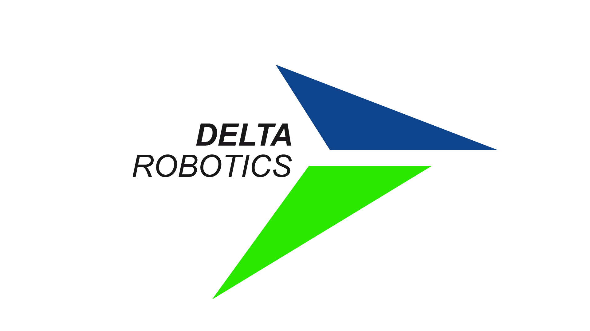

# Remote Acces Parallel Delta Robot Experiment Kit

## Delta Robotics V2 (geliştiriliyor)

V2, aynı robotun uzaktan erişilebilir yeni sürümüdür: kullanıcılar web sayfasından ya da VS Code'dan Python yazarak robotu (ya da dijital ikizini) güvenli bir çerçevede kontrol eder. C++ çekirdek, ROS2 Jazzy, Docker. Tüm V2 çalışması [`DeltaRobotV2/`](DeltaRobotV2/) klasöründedir; durum ve yol haritası için [DeltaRobotV2/README.md](DeltaRobotV2/README.md).

 V2, [Claude Code](https://claude.com/claude-code) ile geliştirilmektedir.

V2 is the remotely accessible rewrite of the same robot; everything lives in [`DeltaRobotV2/`](DeltaRobotV2/).

## V1 (2024, arşiv)

Aşağıdaki metin ve `LikeSoup/`, `KilavuzDeltaRobotics/`, `ImageProcessing/`, `WsAnalysis/` klasörleri 2024 bitirme projesine aittir ve referans olarak değiştirilmeden tutulur.

We are developing Remote Access Parallel Delta Robot Experiment Kit for TEKNOFEST competition. Our team name is DELTA ROBOTICS.

Our project consists of several different areas. These are listed below under the electronic, mechanical and software categories.

<h1>⚡  Electronics:</h1>

We use dynamixel AX12-A smart servos of the robotis brand. We control the entire system with Raspberry pi 4b (8GB). For this case, we fulfill the electronic requirements for communication by using the circuit below.

<h1>⚙️  Mechanics:</h1>

We have a small-sized delta robot design and we are constantly updating our designs as a result of the current tests.

<h1>💻 Softwares:</h1>

We are using raspbian-os on raspberry pi. Since we are in the prototype stage, we use Real-VNC with remote desktop access. We are developing an interface with the tkinter library in Python language. In the following stages, the project will be completely dockerized and the repository will be updated.
